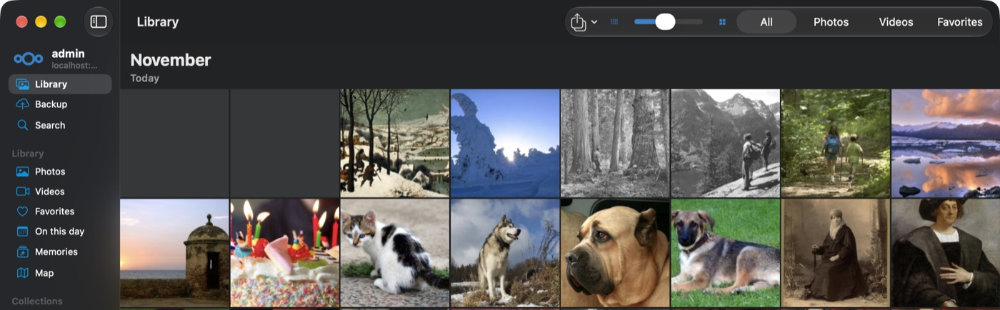
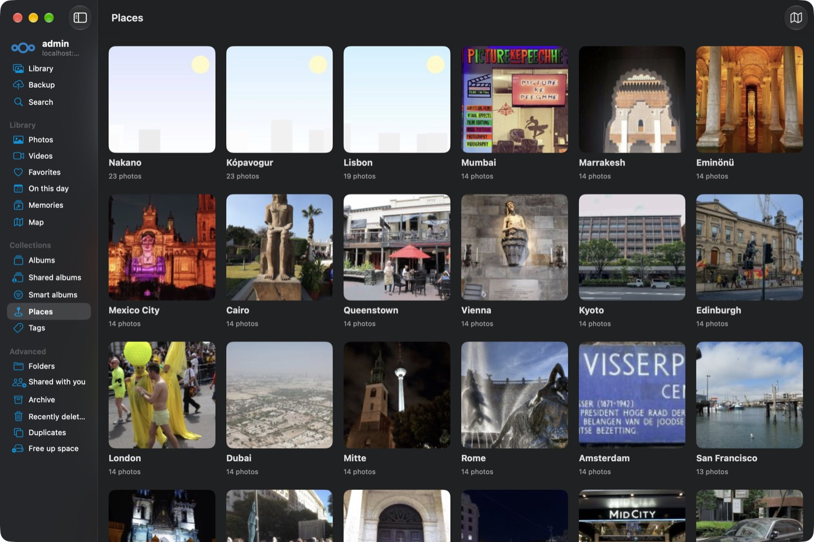

# Nextcloud Photos for iOS, iPadOS, macOS and visionOS

A native Apple app for the photos and videos in your Nextcloud: timeline, albums, sharing, places, people, memories, backup and more.
It works with the [Photos](https://github.com/nextcloud/photos) app on Nextcloud 33 and later.

The product and technical specification is in [docs/SPEC.md](docs/SPEC.md); optional server additions are in
[docs/SERVER-COMPANION.md](docs/SERVER-COMPANION.md). Wire-format research notes are in [docs/reference](docs/reference).

## Screenshots

The Mac app, signed in to a test server with sample photos from Wikimedia Commons:



| Places | Map |
|---|---|
|  |  |

## Build

Requirements: Xcode 27, [XcodeGen](https://github.com/yonaskolb/XcodeGen).

```sh
xcodegen generate          # creates NextcloudPhotos.xcodeproj from project.yml (not checked in)
open NextcloudPhotos.xcodeproj
```

Command-line builds without signing:

```sh
xcodebuild -scheme NextcloudPhotos -destination 'generic/platform=iOS Simulator' CODE_SIGNING_ALLOWED=NO build
xcodebuild -scheme NextcloudPhotos -destination 'platform=macOS' CODE_SIGN_IDENTITY=- CODE_SIGN_STYLE=Manual DEVELOPMENT_TEAM= build
```

### Signing with your own Apple ID

The project defaults to Nextcloud's team. To run on your Mac or devices, create `Config/Local.xcconfig` (git-ignored) from
`Config/Local.xcconfig.example` with your team id and a bundle id you own (not `com.nextcloud.photos`):

```
DEVELOPMENT_TEAM = ABCDE12345
PHOTOS_BUNDLE_ID = com.example.nextcloudphotos
```

Add your Apple ID in Xcode › Settings › Accounts, run `xcodegen generate`, and press Run. Debug builds have no App Group or keychain
group entitlements, so any team can sign them (widgets and extensions then can't see the app's accounts). Release builds use
`group.$(PHOTOS_BUNDLE_ID)` and the matching keychain group, which the signing team must have registered. The macOS App Sandbox
comes from build settings (`ENABLE_APP_SANDBOX`), so the same entitlement files work for iOS.

## Code layout

All code lives in the local Swift package `Packages/PhotosKit`; the app target only contains the entry point and resources.

| Module | Contents |
|---|---|
| `PhotosModel` | Value types (media, albums, accounts, server features). No I/O. |
| `PhotosDomain` | Pure algorithms shared with the web app (timeline sections, stacks, memories, duplicates…). |
| `PhotosNetworking` | HTTP with certificate trust, WebDAV/SEARCH, OCS, Login Flow v2, feature detection, Photos API. |
| `PhotosStore` | GRDB database per account, queries, sync engine, outbox. |
| `PhotosMedia` | Preview cache, image pipeline, originals, BlurHash. |
| `PhotosBackup` | Camera-roll backup (milestone M3). |
| `PhotosCore` | Accounts, keychain, per-account services, app and session models. |
| `PhotosAppUI` | SwiftUI screens and the photo grid (UIKit/AppKit collection views). |

## Tests

```sh
cd Packages/PhotosKit && swift test
```

Integration tests against a real server run when these variables are set (use a test server; the test only reads):

```sh
PHOTOS_IT_SERVER=http://localhost:8089 PHOTOS_IT_USER=admin PHOTOS_IT_PASSWORD=admin swift test --filter IntegrationTests
```

For UI work, Debug builds sign in without a browser when started with
`PHOTOS_DEBUG_LOGIN='nc://login/server:<url>&user:<user>&password:<app password>'`.

## Contributing

Pull requests against `main`; one feature or fix per PR; sign off your commits (DCO). Every source file carries an SPDX header.
Lint with `xcrun swift-format lint --strict --configuration .swift-format` on the changed files.

## Licence

MIT, see [LICENSE](LICENSE). The only third-party dependency is [GRDB](https://github.com/groue/GRDB.swift) (MIT).
The Nextcloud name and logo are trademarks of Nextcloud GmbH.
