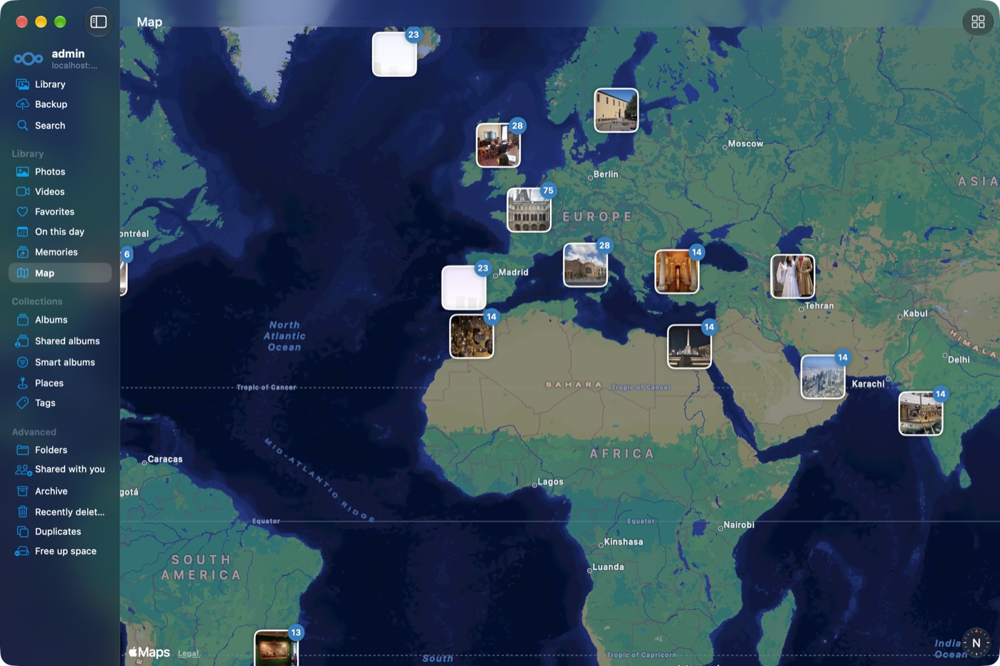

# Nextcloud Photos for iOS, iPadOS, macOS and visionOS

A native Apple app for the photos and videos in your Nextcloud: timeline, albums, sharing, places, people, memories, backup and more.
It works with the [Photos](https://github.com/nextcloud/photos) app on Nextcloud 33 and later.

The product and technical specification (the target) is in [docs/SPEC.md](docs/SPEC.md), what is built so far in
[docs/STATUS.md](docs/STATUS.md), a map of the code in [docs/ARCHITECTURE.md](docs/ARCHITECTURE.md). Optional server
additions are in [docs/SERVER-COMPANION.md](docs/SERVER-COMPANION.md), wire-format research notes in
[docs/reference](docs/reference).

## Screenshots

The Mac app, signed in to a test server with sample photos from Wikimedia Commons:


| Places | Map |
|---|---|
|  |  |

## Build

Requirements: Xcode 27, [XcodeGen](https://github.com/yonaskolb/XcodeGen).

```sh
xcodegen generate          # creates NextcloudPhotos.xcodeproj and the Info.plists from project.yml (not checked in)
open NextcloudPhotos.xcodeproj
```

Command-line builds without signing:

```sh
xcodebuild -scheme NextcloudPhotos -destination 'generic/platform=iOS Simulator' CODE_SIGNING_ALLOWED=NO build
xcodebuild -scheme NextcloudPhotos -destination 'platform=macOS' CODE_SIGN_IDENTITY=- CODE_SIGN_STYLE=Manual DEVELOPMENT_TEAM= build
```

### Signing with your own Apple ID

The project defaults to Nextcloud's team. To run on your Mac or devices, create `Config/Local.xcconfig` (git-ignored) from
`Config/Local.xcconfig.example` with your team id and a bundle id you own (not `com.nextcloud.photos`):

```
DEVELOPMENT_TEAM = ABCDE12345
PHOTOS_BUNDLE_ID = com.example.nextcloudphotos
```

Add your Apple ID in Xcode › Settings › Accounts, run `xcodegen generate`, and press Run.

Debug builds are signed **without entitlements** on purpose, so that any team, and no team at all, can build and run
them. The price: no App Group, no shared keychain and no push, so widgets and extensions cannot see the app's
accounts. To test those, register what the next section lists for your own bundle id and add
`PHOTOS_DEBUG_ENTITLEMENTS = YES` to `Config/Local.xcconfig`. The macOS App Sandbox comes from build settings
(`ENABLE_APP_SANDBOX`), so it is on in every build.

### Release builds: what must exist in the Apple developer account

Release builds are signed with the entitlement files (`App/NextcloudPhotos.entitlements`, on macOS
`App/NextcloudPhotos-macOS.entitlements`, and one per extension). For the official app (team `NKUJUXUJ3B`):

| What | Value | Needed by |
|---|---|---|
| App IDs | `com.nextcloud.photos`, `.share`, `.notification-service`, `.widgets` | app and extensions |
| App Group | `group.com.nextcloud.photos`, enabled on all four App IDs | accounts, databases and caches shared with the extensions |
| App Groups of the Files app | `group.com.nextcloud.apps`, `group.it.twsweb.Crypto-Cloud`, enabled on the app's App ID | backup: reading what the Files app already uploaded |
| Keychain Sharing | group `$(AppIdentifierPrefix)com.nextcloud.photos` (needs no registration; all four targets must be signed by the same team) | app passwords and push keys for the extensions |
| Push Notifications | capability on `com.nextcloud.photos`, and an APNs key or certificate for it | push |
| Push proxy | `push-notifications.nextcloud.com` must accept the topic `com.nextcloud.photos` (server side, not in the developer portal) | push |
| Notification filtering | `com.apple.developer.usernotifications.filtering` on the notification service extension. **Apple grants it on request only.** It is not in the entitlement file yet: add it to `Extensions/NotificationService/NotificationService.entitlements` once granted. Without it the extension cannot hide notifications of the server that are not about photos | push |
| Provisioning profiles | one per App ID and platform (iOS, macOS, visionOS), or automatic signing with an App Store Connect API key | all |

The entitlement files say `aps-environment = development` (macOS: `com.apple.developer.aps-environment`); exporting an
archive for TestFlight or the App Store switches it to `production`. Version and build number are `MARKETING_VERSION`
and `PHOTOS_BUILD_NUMBER` in `Config/Base.xcconfig`; CI overrides the build number on the command line
(`xcodebuild … PHOTOS_BUILD_NUMBER=123`). `.github/workflows/release.yml` archives all three platforms, unsigned
until the signing secrets exist.

App Store declarations (privacy manifest, the App Transport Security exception and its justification for App Review,
export compliance) are explained in [docs/PRIVACY-AND-EXPORT.md](docs/PRIVACY-AND-EXPORT.md); what the app icon still
needs from a designer in [docs/APP-ICON.md](docs/APP-ICON.md).

## Code layout

All code lives in the local Swift package `Packages/PhotosKit`; the app target only contains the entry point and resources.

| Module | Contents |
|---|---|
| `PhotosModel` | Value types (media, albums, accounts, server features). No I/O. |
| `PhotosDomain` | Pure algorithms shared with the web app (timeline sections, stacks, memories, duplicates…). |
| `PhotosNetworking` | HTTP with certificate trust, WebDAV/SEARCH, OCS, Login Flow v2, feature detection, Photos API. |
| `PhotosStore` | GRDB database per account, queries, sync engine, outbox. |
| `PhotosMedia` | Preview cache, image pipeline, originals, BlurHash. |
| `PhotosBackup` | Camera-roll backup (milestone M3). |
| `PhotosCore` | Accounts, keychain, per-account services, app and session models. |
| `PhotosAppUI` | SwiftUI screens and the photo grid (UIKit/AppKit collection views). |

## Tests

The unit tests need macOS 27 (the package's deployment target). Either of these runs all of them:

```sh
cd Packages/PhotosKit
swift test
xcodebuild test -scheme PhotosKit-Package -destination 'platform=macOS'   # what CI runs
```

With `xcodebuild`, environment variables only reach the tests with the prefix `TEST_RUNNER_`
(`TEST_RUNNER_PHOTOS_SKIP_PERFORMANCE=1 xcodebuild test …` skips the slow timing tests).

All CI jobs run on GitHub's `xcode-27` runner (macOS 27), except REUSE (Linux): lint, the unit tests on macOS and in an
iOS 27 simulator (a job fails when no test ran), Debug builds for iOS, macOS and visionOS, and an unsigned Release
archive of each. A nightly workflow runs the timing tests and the integration tests against a Nextcloud that it
installs on the runner.

Integration tests against a real server, UI smoke tests and the manual test plan for devices are described in
[docs/TESTING.md](docs/TESTING.md) and [docs/test-plan.md](docs/test-plan.md). In short:

```sh
scripts/test-server.sh /tmp/photos-test-server 8089     # a throw-away Nextcloud with sample photos
PHOTOS_IT_SERVER=http://127.0.0.1:8089 PHOTOS_IT_USER=admin PHOTOS_IT_PASSWORD=admin swift test --no-parallel --filter Integration
```

## Contributing

See [CONTRIBUTING.md](CONTRIBUTING.md): pull requests against `main`, one feature or fix each, signed off (DCO), with
tests; Nextcloud's AI contribution policy applies. Security issues: [SECURITY.md](SECURITY.md).

## Licence

MIT, see [LICENSE](LICENSE). The only third-party dependency is [GRDB](https://github.com/groue/GRDB.swift) (MIT).
The Nextcloud name and logo are trademarks of Nextcloud GmbH.
