<p align="center">
  
</p>

<h1 align="center">Nextcloud Photos</h1>

<p align="center">
  <b>All your photos and videos, on the Nextcloud you trust, in a fast native app for every Apple device.</b><br>
  iPhone · iPad · Mac · Apple Vision Pro · Apple TV · Apple Watch
</p>

<p align="center">
  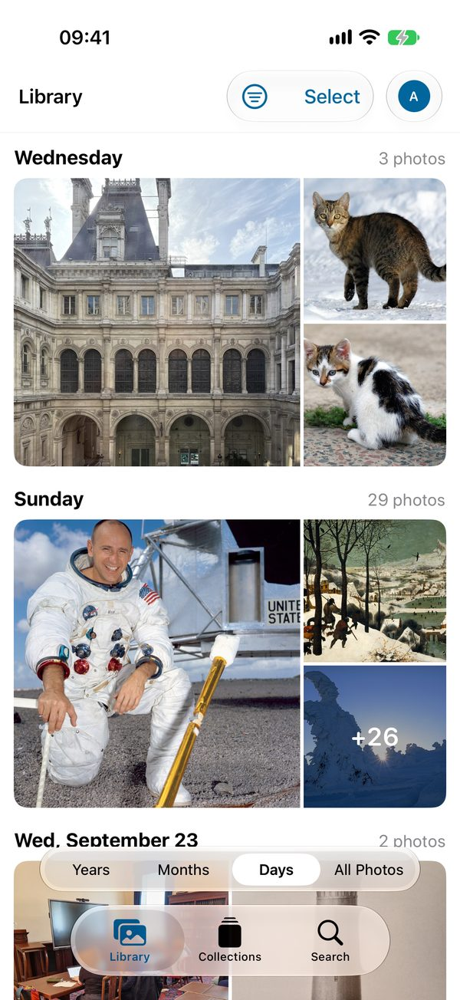
  &nbsp;
  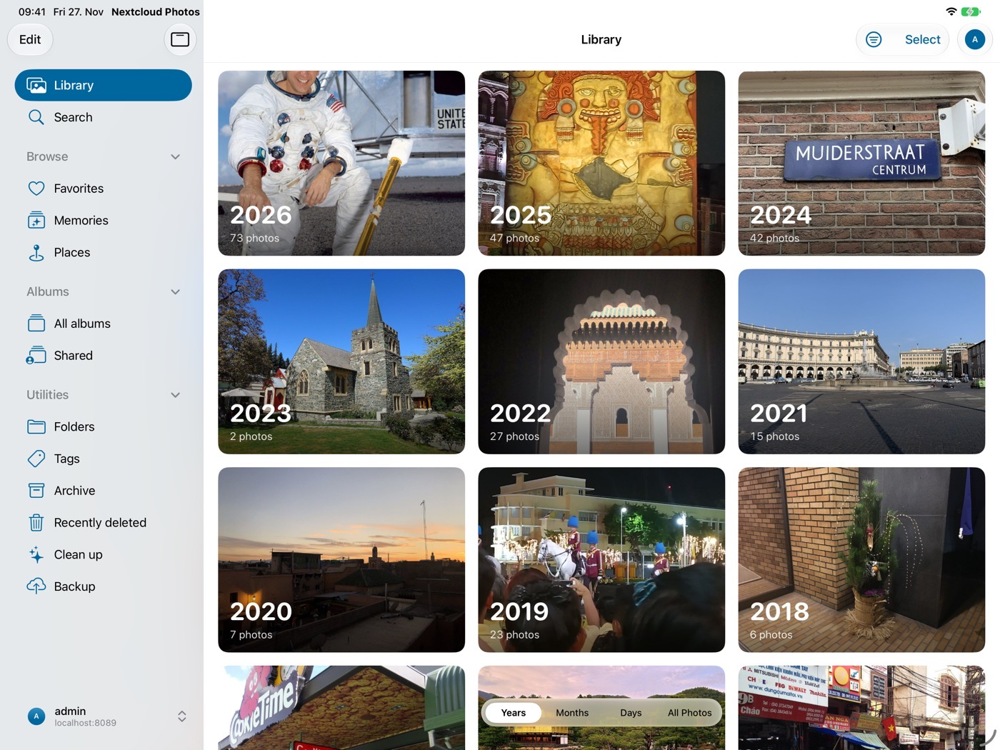
  &nbsp;
  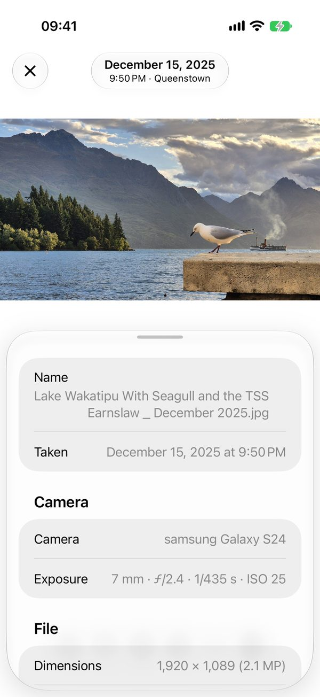
</p>

Nextcloud Photos brings your Nextcloud's photo library to iPhone, iPad, Mac, Apple Vision Pro, Apple TV and Apple Watch.
It is built with SwiftUI for each platform (no web views, no Catalyst), works with the Photos app that comes with your
Nextcloud, and needs no changes on your server. Your photos stay where they are: on your server, under your control.

The screenshots show the real app, signed in to a test server with sample photos from Wikimedia Commons.

## Your whole library, instantly

The library is indexed on your device, so even a large library opens and scrolls without waiting for the server, also
offline. Pinch from years to months to days to every photo, or jump through time with the date scroller. Days that
belong together get a name ("Weekend in Lisbon"), copies of one shot (RAW + JPEG, HEIC + JPEG) and bursts stack into one
tile, and the photos you are likely to open next are already on the device.

<table>
  <tr>
    <td>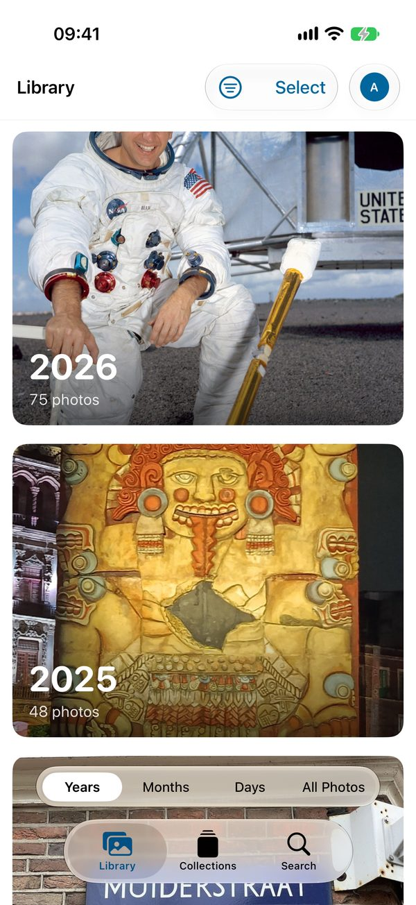</td>
    <td>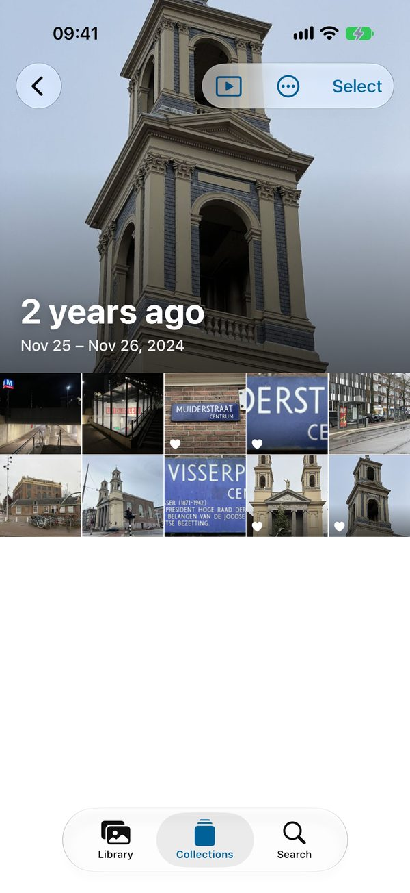</td>
  </tr>
  <tr>
    <td align="center">Years, months, days or every photo</td>
    <td align="center">A memory from two years ago</td>
  </tr>
</table>

## Memories that tell a story

On this day and your trips come together as memories at the top of the Library. Play one and it becomes a film: a
title card, slow moves towards the faces in each photo, cross-fades between days and map flights between the stops of a
trip. Pick a style (Cinematic, Upbeat, Black & White, Super 8, Calm) and export it as a video to share.

## Every photo, full screen

The viewer puts the photo first: pinch or double-tap to zoom, swipe between photos, swipe down to close and the photo
lands back in its tile. Swipe up for the details — date, place on a map, camera and exposure, file and folder.
Copies of one shot sit side by side in a strip, and a slideshow starts from any photo or grid.

<p align="center">
  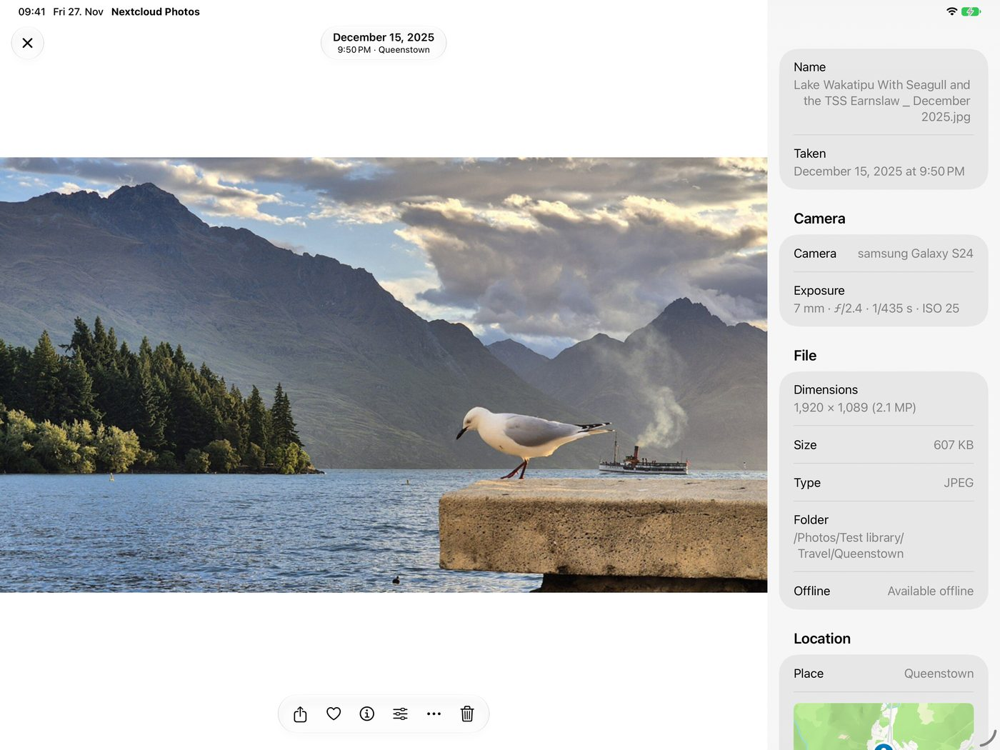
</p>

## Everywhere you've been

Places shows your photos on a map, grouped as you zoom, with a time range to see one summer or one decade. "Then and
now" finds the spots you have photographed over the years, and the travel globe draws your trips. People and faces
appear when your server runs [Recognize](https://apps.nextcloud.com/apps/recognize).

<table>
  <tr>
    <td>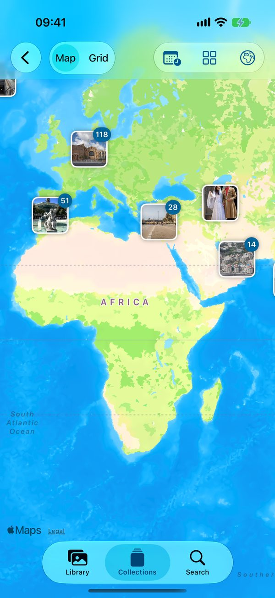</td>
    <td>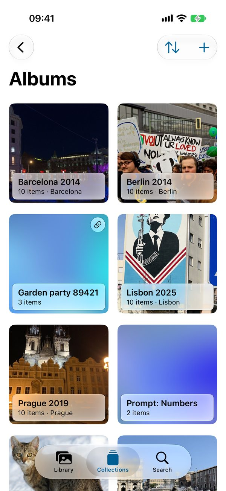</td>
    <td>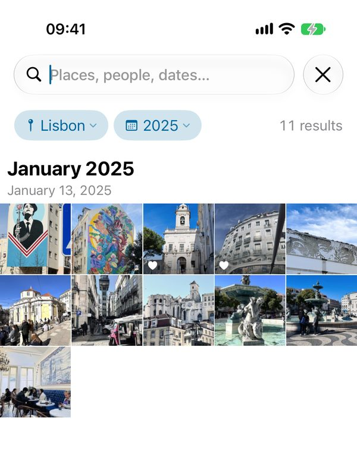</td>
  </tr>
  <tr>
    <td align="center">Places on a map</td>
    <td align="center">Albums</td>
    <td align="center">Search in your own words</td>
  </tr>
</table>

## Albums and sharing

Create albums, add photos from the library's grid, open the albums others share with you, and share an album with
anyone through a public link. Share photos and folders the Nextcloud way — with users, groups, Talk conversations or a
link with a password and an expiry date. Smart albums fill themselves from rules (people, places, dates, cameras,
ratings…) and are the same on all your devices. Send a photo as a postcard, find the photos in a family member's shared
folder that belong with yours, or hand your phone to someone with Guest Mode, which shows one album and nothing else.

## Find any photo

Type the way you think: "Lisbon 2025" or "favourite photos from Lisbon" become chips for a place, a date and your
favourites, and each chip can be changed with a tap. Search looks at places, dates, file names, albums, tags and people —
and, once you turn it on, at what is in your photos: labels, short descriptions and the text on signs, which Apple's
Vision framework finds on your device. On devices with Apple Intelligence, its on-device language model helps to
understand what you type. Quick Actions (⌘K) jump to any album, place, year or command.

## Edit without losing the original

Edits are saved as a small recipe next to your photo on your Nextcloud, never in the photo itself, so they can be changed
or undone at any time and show up on all your devices. Besides light, colour, crop and filters there are curves, a colour
mixer for each hue, masks for the sky, the subject or the people in a photo, noise reduction and presets. Copy the edits
of one photo and paste them onto others. When you want the result in the file itself, Apply Edits to the File writes it
and keeps the original as a version on your Nextcloud.

**Erase** removes dust, spots and small distractions: tap them or brush over them, and the area is filled from what is
around it. It works best on spots and small things on even backgrounds.

<table>
  <tr>
    <td>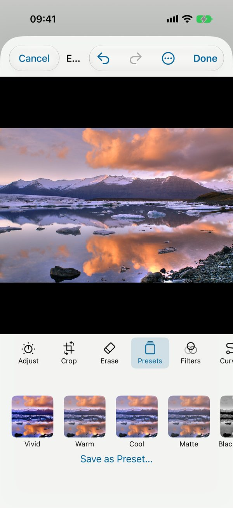</td>
    <td>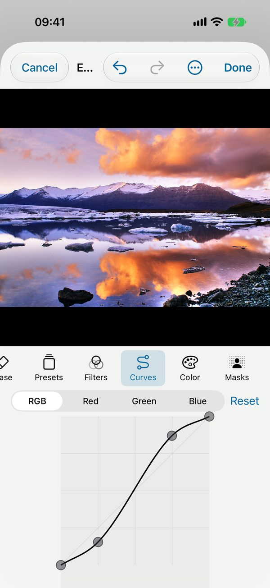</td>
    <td>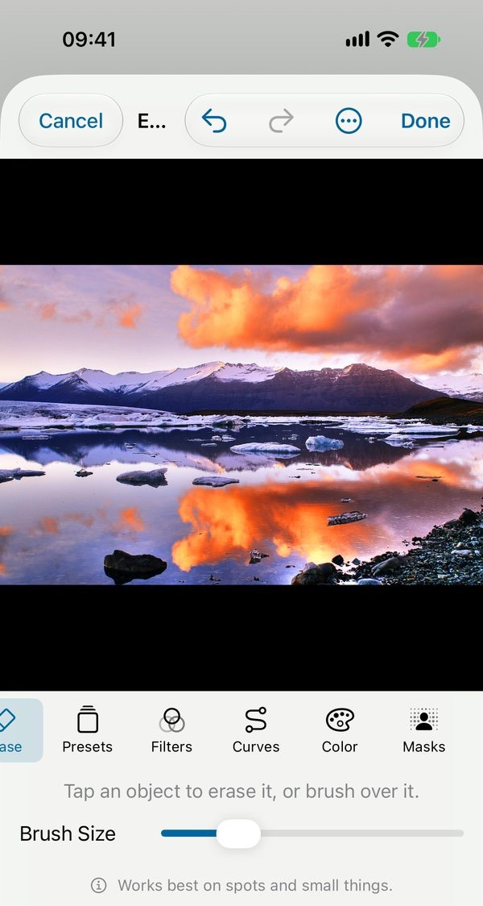</td>
  </tr>
  <tr>
    <td align="center">Presets</td>
    <td align="center">Curves</td>
    <td align="center">Erase</td>
  </tr>
</table>

<p align="center">
  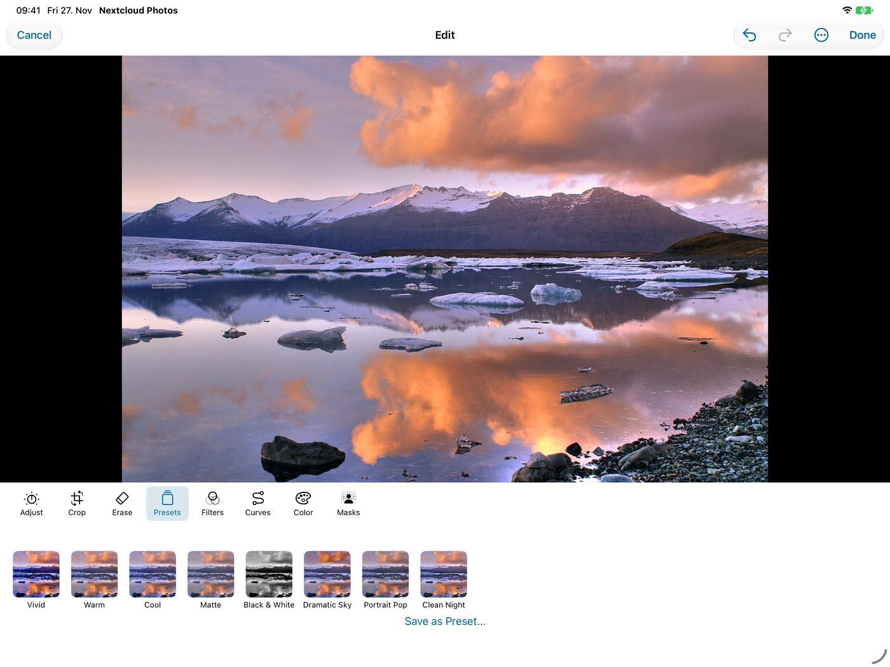
</p>

## The best shot, and room to spare

When you take ten photos of the same moment, the app picks the best one — sharp, well exposed, eyes open — and tells you
why. Bursts and quick series stack behind their best frame in the Library. **Clean up** gathers duplicates, similar
shots, large videos and screenshots in one place, says how much space each would free, and lets you keep what you like.

## Backup you can see

Turn on backup and your new photos and videos go to your Nextcloud — in full quality, Live Photos with their motion.
Photos that are on your phone but not on your server yet stand in the Library with a small badge, so you always know
what is safe; the account menu counts them, and "Back Up Now" sends any photo at once. Large videos resume
where they stopped after a lost connection or a restart. If you have used the Nextcloud Files app's auto upload, the app
sees what is already there and never uploads a photo twice.

<table>
  <tr>
    <td>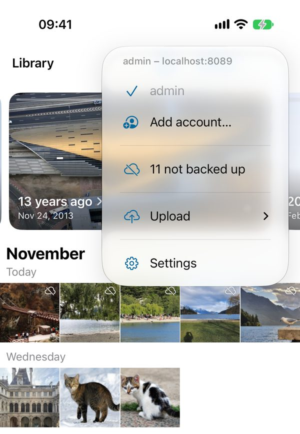</td>
    <td>
      Moving from another service? <b>Import</b> reads a Google Takeout, Apple's iCloud Photos export, or a Facebook or
      Instagram download, keeps dates, albums and favourites, and skips what is already on your Nextcloud.
      <br><br>
      While a backup runs, a Live Activity shows its progress on the Lock Screen and in the Dynamic Island, and Control
      Center has switches for it.
    </td>
  </tr>
</table>

## Made for every Apple device

**iPhone and iPad** — Liquid Glass, a sidebar on iPad, several windows with drag and drop between them, keyboard
shortcuts, Home Screen widgets, Controls and the backup Live Activity.

**Mac** — a real Mac app: a full menu bar and keyboard control, smooth trackpad zoom, and tools for photographers —
ratings and flags with one key, compare two or four photos side by side, and Insights into your cameras, lenses and
settings.

<p align="center">
  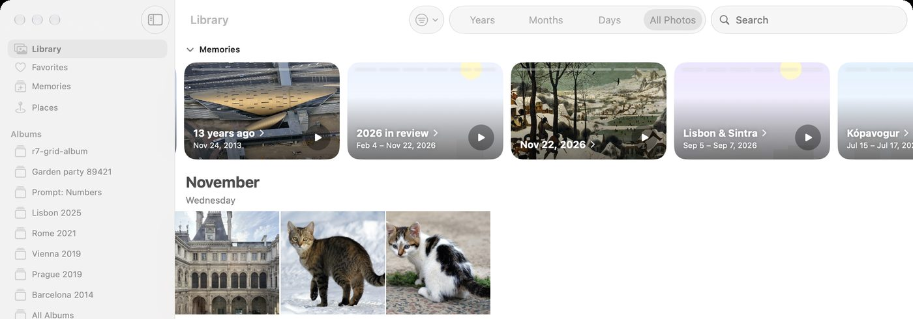
</p>
<table>
  <tr>
    <td>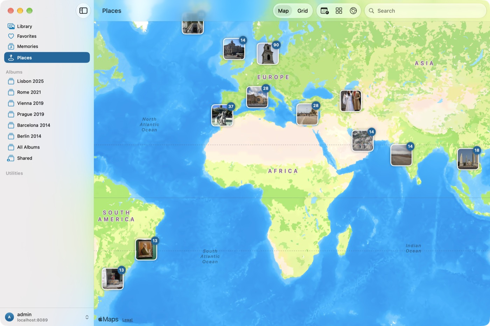</td>
    <td>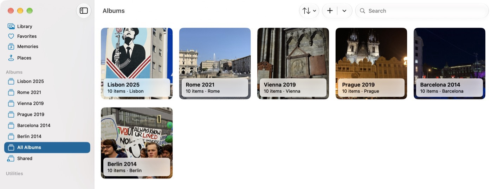</td>
  </tr>
</table>

**Apple Vision Pro** — the app in a window of glass, with its controls in ornaments below it. Open a memory in the
Memory Room and its photos hang framed all around you.

<table>
  <tr>
    <td>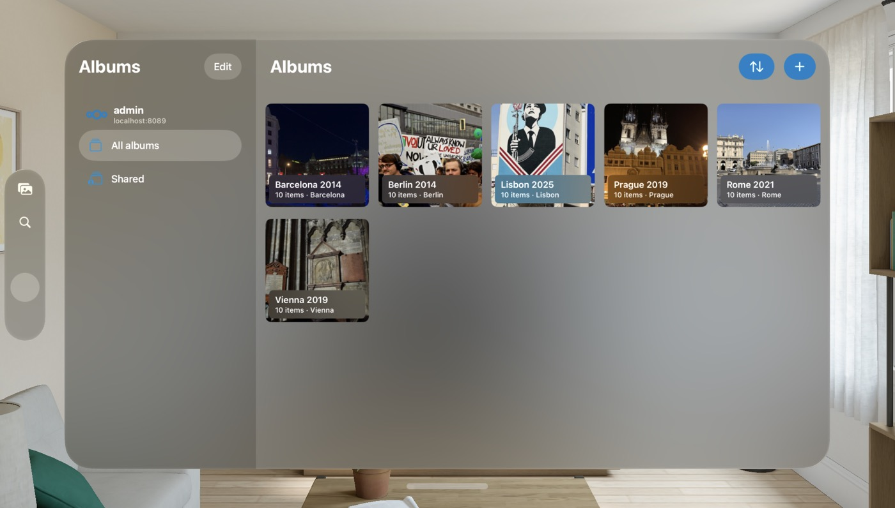</td>
    <td>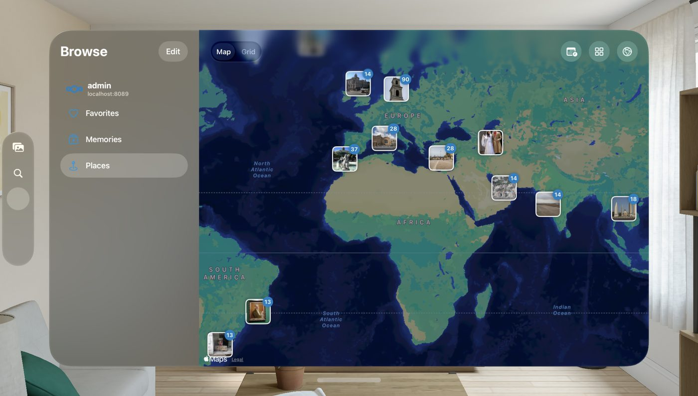</td>
  </tr>
</table>

**Apple TV** — memories, favourites and albums on the big screen, slideshows that drift and dissolve, a family slideshow
that keeps going, and your newest memories in the Top Shelf. Sign in by scanning a QR code with your phone.

**Apple Watch** — a photo of the day and the photos from this day in earlier years on your wrist, sent by the iPhone app.

<table>
  <tr>
    <td>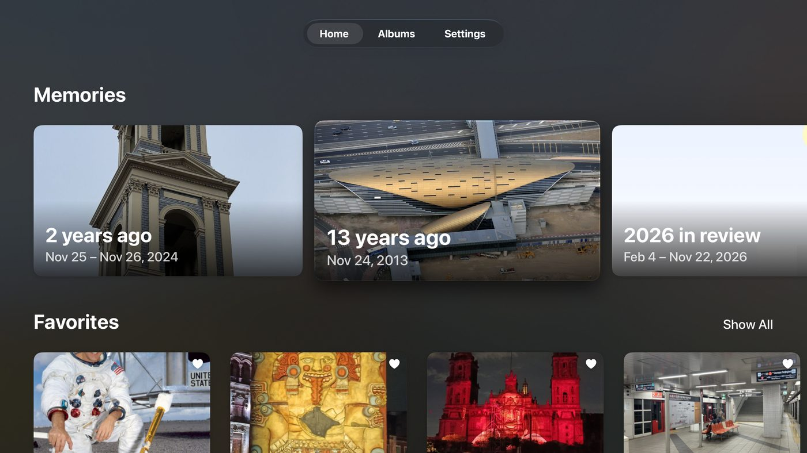</td>
    <td></td>
    <td></td>
  </tr>
</table>

## Private by design

- **Your photos stay on your Nextcloud.** They go to your server and nowhere else. The app has no analytics, no ads and
  no third-party trackers.
- **Intelligence on your device, from Apple.** Labels, descriptions, faces in films, the best shot and the masks come
  from Apple's own frameworks — Vision, VisionKit, Core Image and, where available, Apple Intelligence — running on your
  device. The app never ships or downloads AI models of its own, and no photo is sent anywhere else to be analysed.
- **Locked when you want it.** App lock with Face ID, Touch ID or Optic ID; archived photos and Recently Deleted always
  ask first.
- **Nothing to install on the server.** The app works with the Photos app that comes with Nextcloud and finds out by
  itself what your server offers.

## For everyone

Photos, cards and controls have VoiceOver labels, text grows to the largest accessibility sizes, and the app follows
Reduce Motion, Reduce Transparency and Increase Contrast. Every main screen passes Apple's accessibility audit, at the
default and at the largest text size, in our UI tests. The app is in English today, and every text is ready for
translation ([docs/LOCALIZATION.md](docs/LOCALIZATION.md)).

## Requirements

- **Server:** Nextcloud 33 or later with its [Photos](https://github.com/nextcloud/photos) app (included with
  Nextcloud). Newer Photos versions add features, which the app switches on by itself.
- **Optional server apps:** [Recognize](https://apps.nextcloud.com/apps/recognize) for People and faces; the Tags,
  Trash bin and Talk apps for tags, Recently Deleted and sharing to conversations.
- **Devices:** iOS 27, iPadOS 27, macOS 27, visionOS 27, tvOS 27 or watchOS 27 (the watch app comes with the iPhone
  app).

---

## For developers

The product and technical specification (the target) is in [docs/SPEC.md](docs/SPEC.md), what is built so far in
[docs/STATUS.md](docs/STATUS.md), a map of the code in [docs/ARCHITECTURE.md](docs/ARCHITECTURE.md). Optional server
additions are in [docs/SERVER-COMPANION.md](docs/SERVER-COMPANION.md), wire-format research notes in
[docs/reference](docs/reference). The screenshots above come from `scripts/readme-screenshots.sh`, which also notes how
the Mac and Apple Watch shots are made.

### Build

Requirements: Xcode 27, [XcodeGen](https://github.com/yonaskolb/XcodeGen).

```sh
xcodegen generate          # creates NextcloudPhotos.xcodeproj and the Info.plists from project.yml (not checked in)
open NextcloudPhotos.xcodeproj
```

Command-line builds without signing:

```sh
xcodebuild -scheme NextcloudPhotos -destination 'generic/platform=iOS Simulator' CODE_SIGNING_ALLOWED=NO build
xcodebuild -scheme NextcloudPhotos -destination 'platform=macOS' CODE_SIGN_IDENTITY=- CODE_SIGN_STYLE=Manual DEVELOPMENT_TEAM= build
xcodebuild -scheme NextcloudPhotosTV -destination 'generic/platform=tvOS Simulator' CODE_SIGNING_ALLOWED=NO build
xcodebuild -scheme NextcloudPhotosWatch -destination 'generic/platform=watchOS Simulator' CODE_SIGNING_ALLOWED=NO build
```

The watch app is also built and embedded by the iOS build of `NextcloudPhotos`.

#### Signing with your own Apple ID

The project defaults to Nextcloud's team. To run on your Mac or devices, create `Config/Local.xcconfig` (git-ignored) from
`Config/Local.xcconfig.example` with your team id and a bundle id you own (not `com.nextcloud.photos`):

```
DEVELOPMENT_TEAM = ABCDE12345
PHOTOS_BUNDLE_ID = com.example.nextcloudphotos
```

Add your Apple ID in Xcode › Settings › Accounts, run `xcodegen generate`, and press Run.

Debug builds are signed **without entitlements** on purpose, so that any team, and no team at all, can build and run
them. The price: no App Group, no shared keychain and no push, so widgets and extensions cannot see the app's
accounts. To test those, register what the next section lists for your own bundle id and add
`PHOTOS_DEBUG_ENTITLEMENTS = YES` to `Config/Local.xcconfig`. The macOS App Sandbox comes from build settings
(`ENABLE_APP_SANDBOX`), so it is on in every build.

#### Release builds: what must exist in the Apple developer account

Release builds are signed with the entitlement files (`App/NextcloudPhotos.entitlements`, on macOS
`App/NextcloudPhotos-macOS.entitlements`, and one per extension). For the official app (team `NKUJUXUJ3B`):

| What | Value | Needed by |
|---|---|---|
| App IDs | `com.nextcloud.photos`, `.share`, `.notification-service`, `.widgets`, `.background-upload` | app and extensions |
| App IDs (Apple TV) | `com.nextcloud.photos.tv`, `com.nextcloud.photos.tv.topshelf` | the Apple TV app and its Top Shelf (SPEC §15.3). A separate App Store app; for universal purchase with the iPhone app the TV target would use `com.nextcloud.photos` itself (decision for Nextcloud) |
| App IDs (Apple Watch) | `com.nextcloud.photos.watchkitapp`, `com.nextcloud.photos.watchkitapp.widgets` | the watch app (shipped inside the iPhone app) and its complication |
| App Group | `group.com.nextcloud.photos`, enabled on all five App IDs and on the four TV and watch App IDs | accounts, databases and caches shared with the extensions; the share extension's uploads that the app finishes; on the TV and the watch (separate devices, same group name) what their Top Shelf and complication show |
| App Groups of the Files app | `group.com.nextcloud.apps`, `group.it.twsweb.Crypto-Cloud`, enabled on the app's App ID | backup: reading what the Files app already uploaded |
| Keychain Sharing | group `$(AppIdentifierPrefix)com.nextcloud.photos` (needs no registration; all five targets must be signed by the same team) | app passwords and push keys for the extensions |
| Keychain (Apple TV) | group `$(AppIdentifierPrefix)com.nextcloud.photos.tv` (no registration) | the TV's app password |
| PhotoKit background uploads | `com.apple.photos.background-upload` on `com.nextcloud.photos.background-upload` (iOS and macOS). The extension point requires it (`EXRequiredEntitlements` of `com.apple.photos.background-upload` on macOS 27.3); it is in `Extensions/BackgroundUpload/BackgroundUpload.entitlements`. **Has to be enabled for Nextcloud's App ID** (check in the developer portal whether Apple grants it on request, as for the Files app's extension). Without it the system never starts the extension and the backup uses the app's own background session only | backup (SPEC §7.18.6) |
| Push Notifications | capability on `com.nextcloud.photos`, and an APNs key or certificate for it | push |
| Push proxy | `push-notifications.nextcloud.com` must accept the topic `com.nextcloud.photos` (server side, not in the developer portal) | push |
| Notification filtering | `com.apple.developer.usernotifications.filtering` on the notification service extension. **Apple grants it on request only.** It is not in the entitlement file yet: add it to `Extensions/NotificationService/NotificationService.entitlements` once granted. Without it the extension cannot hide notifications of the server that are not about photos | push |
| Provisioning profiles | one per App ID and platform (iOS, macOS, visionOS, tvOS, watchOS), or automatic signing with an App Store Connect API key | all |
| Apple TV artwork | layered app icon (400×240, 1280×768) and Top Shelf images (1920×720, 2320×720); `App/TV/Assets.xcassets` has placeholders made from the app icon | App Store |

The entitlement files say `aps-environment = development` (macOS: `com.apple.developer.aps-environment`); exporting an
archive for TestFlight or the App Store switches it to `production`. Version and build number are `MARKETING_VERSION`
and `PHOTOS_BUILD_NUMBER` in `Config/Base.xcconfig`; CI overrides the build number on the command line
(`xcodebuild … PHOTOS_BUILD_NUMBER=123`). `.github/workflows/release.yml` archives all three platforms, unsigned
until the signing secrets exist.

App Store declarations (privacy manifest, the App Transport Security exception and its justification for App Review,
export compliance) are explained in [docs/PRIVACY-AND-EXPORT.md](docs/PRIVACY-AND-EXPORT.md); what the app icon still
needs from a designer in [docs/APP-ICON.md](docs/APP-ICON.md).

### Code layout

All code lives in the local Swift package `Packages/PhotosKit`; the app target only contains the entry point and resources.
The exceptions are the Apple TV app (`App/TV`, Top Shelf in `Extensions/TopShelf`) and the Apple Watch app (`App/Watch`,
complication in `Extensions/WatchWidgets`): their screens are made for the Siri Remote and the watch and share no UI
with `PhotosAppUI`; their logic is in the package (SPEC §15.3).

| Module | Contents |
|---|---|
| `PhotosModel` | Value types (media, albums, accounts, server features). No I/O. |
| `PhotosDomain` | Pure algorithms shared with the web app (timeline sections, stacks, memories, duplicates…). |
| `PhotosNetworking` | HTTP with certificate trust, WebDAV/SEARCH, OCS, Login Flow v2, feature detection, Photos API. |
| `PhotosStore` | GRDB database per account, queries, sync engine, outbox. |
| `PhotosMedia` | Preview cache, image pipeline, originals, BlurHash. |
| `PhotosBackup` | Camera-roll backup (milestone M3). |
| `PhotosCore` | Accounts, keychain, per-account services, app and session models. |
| `PhotosAppUI` | SwiftUI screens and the photo grid (UIKit/AppKit collection views). |

### Tests

The unit tests need macOS 27 (the package's deployment target). Either of these runs all of them:

```sh
cd Packages/PhotosKit
swift test
xcodebuild test -scheme PhotosKit-Package -destination 'platform=macOS'   # what CI runs
```

With `xcodebuild`, environment variables only reach the tests with the prefix `TEST_RUNNER_`
(`TEST_RUNNER_PHOTOS_SKIP_PERFORMANCE=1 xcodebuild test …` skips the slow timing tests).

All CI jobs run on GitHub's `xcode-27` runner (macOS 27), except REUSE (Linux): lint, the unit tests on macOS and in an
iOS 27 simulator (a job fails when no test ran), Debug builds for iOS, macOS and visionOS, and an unsigned Release
archive of each. A nightly workflow runs the timing tests and the integration tests against a Nextcloud that it
installs on the runner.

Integration tests against a real server, UI smoke tests and the manual test plan for devices are described in
[docs/TESTING.md](docs/TESTING.md) and [docs/test-plan.md](docs/test-plan.md). In short:

```sh
scripts/test-server.sh /tmp/photos-test-server 8089     # a throw-away Nextcloud with sample photos
PHOTOS_IT_SERVER=http://127.0.0.1:8089 PHOTOS_IT_USER=admin PHOTOS_IT_PASSWORD=admin swift test --no-parallel --filter Integration
```

## Contributing

See [CONTRIBUTING.md](CONTRIBUTING.md): pull requests against `main`, one feature or fix each, signed off (DCO), with
tests; Nextcloud's AI contribution policy applies. Security issues: [SECURITY.md](SECURITY.md).

## Licence

MIT, see [LICENSE](LICENSE). The only third-party dependency is [GRDB](https://github.com/groue/GRDB.swift) (MIT).
The Nextcloud name and logo are trademarks of Nextcloud GmbH.
